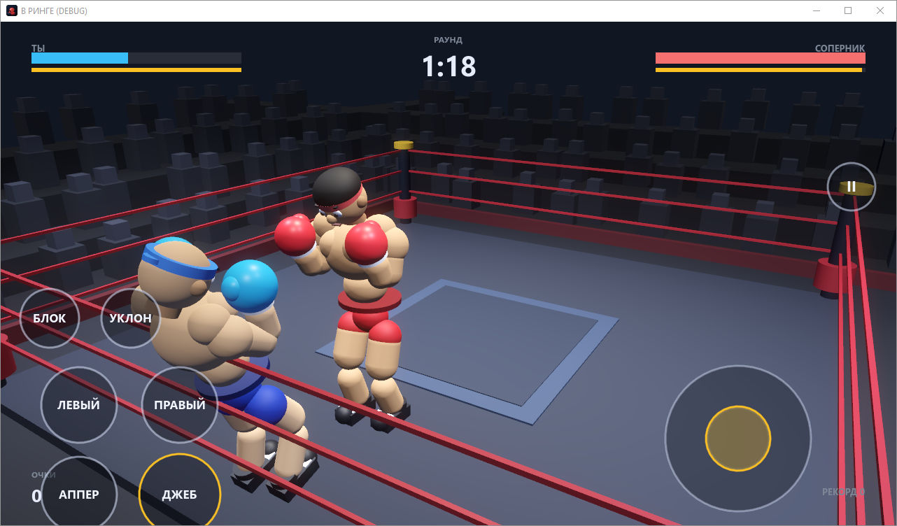
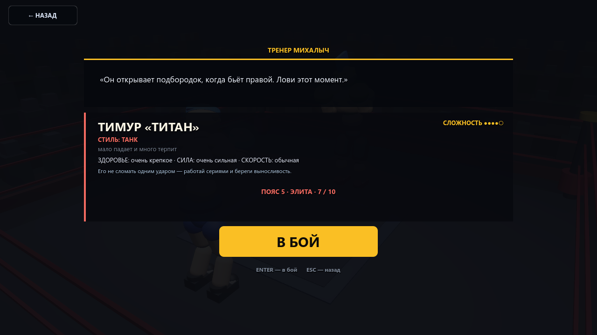
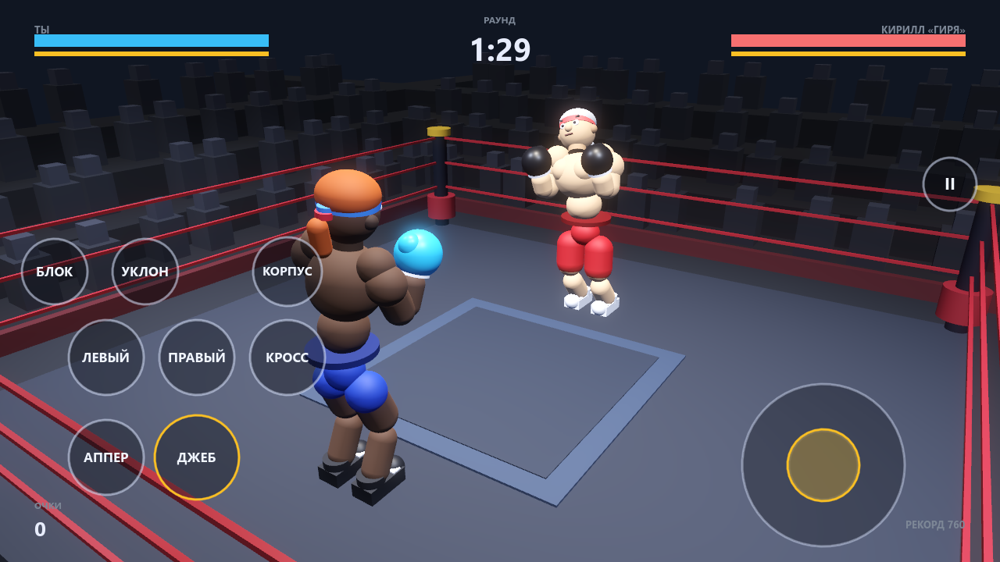
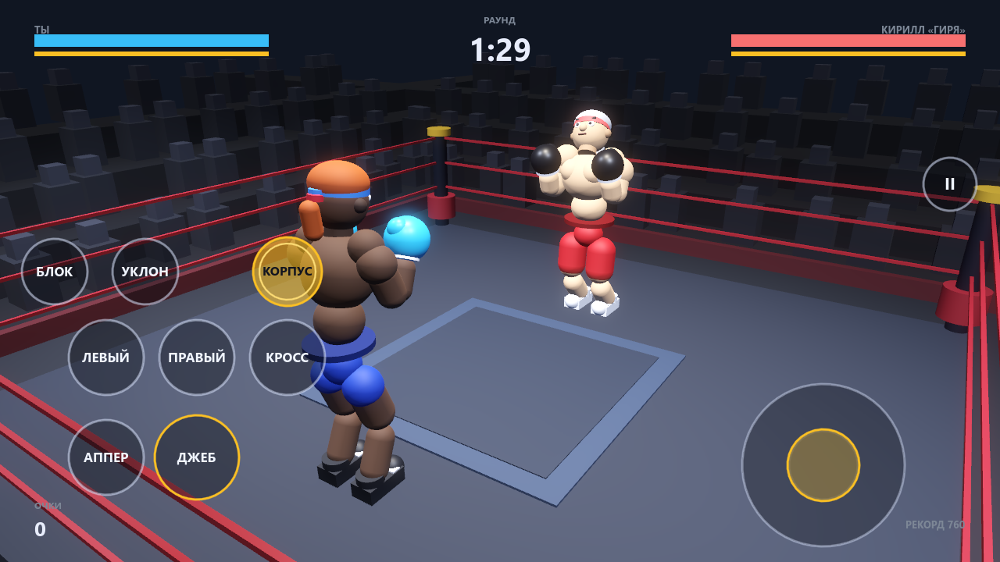
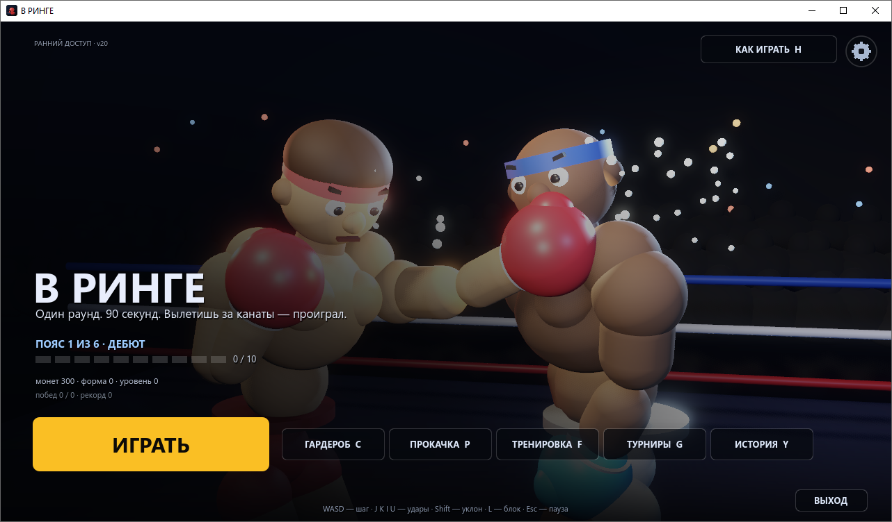

# В РИНГЕ — мобильная версия (Android + браузер)

Тот же бокс на Godot 4.7, но под телефон: сенсорное управление, ландшафтный экран,
удары в левом нижнем углу, стик движения справа.



## Установка на Android

1. Скачай **APK** из раздела [Releases](../../releases) (`Ring3D-mobile.apk`, ~58 МБ).
2. Открой файл на телефоне. Android спросит разрешение на установку из этого источника —
   разреши (Настройки → Приложения → Особый доступ → Установка неизвестных приложений).
3. Поставь и запусти. Приложение называется «В РИНГЕ», ярлык появится на рабочем столе.

Требования: Android 7.0 (API 24) и новее, ARM-процессор (обычный телефон подходит).

APK подписан отладочным ключом — это нормально для личной сборки, в магазин так не
выкладывают. При обновлении поверх старой версии данные сохраняются.

## Играть в браузере

Есть веб-сборка прямо в репозитории: открой
https://kirtus228.github.io/v-ringe-mobile/ на телефоне (Chrome / Яндекс.Браузер).
Можно добавить на главный экран — будет как приложение. Первый запуск качает ~40 МБ,
дальше браузер кеширует.

## Управление

| Что | Где |
|---|---|
| Пять ударов: джеб, кросс, два хука, апперкот | кнопки `ДЖЕБ`, `КРОСС`, `ЛЕВЫЙ`, `ПРАВЫЙ`, `АППЕР` слева внизу |
| Удары в корпус | кнопка-переключатель `КОРПУС` (горит янтарным — все удары идут по корпусу, повторный тап выключает) |
| Блок | кнопка «БЛОК» — держать пальцем |
| Уклон | кнопка «УКЛОН» — тап |
| Движение | стик справа внизу (тяни пальцем) |
| Пауза | кнопка «II» справа сверху |
| Меню, гардероб, настройки | обычный тап по кнопкам |
| Назад | кнопка «← НАЗАД» в левом верхнем углу (и системная кнопка Android) |

Раскладка в бою: `ЛЕВЫЙ` · `ПРАВЫЙ` · `КРОСС` в верхнем ряду, под ними `АППЕР` ·
`ДЖЕБ`; над ударами ряд `БЛОК` · `УКЛОН` · `КОРПУС`. Переключатель корпуса
сбрасывается при входе в новый бой, чтобы удар не ушёл не туда случайно.

## Что внутри

- Карьера: 6 поясов по 10 соперников, сложность растёт каждый бой (60 уровней).
- Восемь стилей соперников (панчер, скоростник, защитник, агрессор, снайпер,
  контрбоксёр, танк, клинчер), 60 разных имён и внешностей; карточка перед боем
  показывает стиль, силу, скорость и сложность.
- Без прокачки высокие пояса не проходятся — форма идёт в силу, защиту, здоровье.
- Живые траектории ударов: крюк заходит сбоку с разворотом корпуса, апперкот идёт
  снизу с проседанием коленей, прямые — почти по нитке.
- Поражение списывает 40 монет (один раз за бой, настраивается в коде).
- Сюжетные турниры, награды, прокачка за «форму», гардероб.
- Тренер Михалыч: совет перед боем и разбор после.
- История: пролог и шесть глав.
- Язык RU/EN, громкость музыки и звуков боя, сохранение прогресса.









## Как собрать

Нужны Godot 4.7.2, Android SDK (build-tools 34, platform 34) и JDK 17.

```bash
godot --headless --path . --export-debug "Android" build/android/Ring3D-mobile.apk
```

Веб-сборка:

```bash
godot --headless --path . --export-release "Web" build/web/index.html
```

## ПК-версия

[github.com/Kirtus228/v-ringe](https://github.com/Kirtus228/v-ringe) — Windows-сборка
с клавиатурным управлением.
